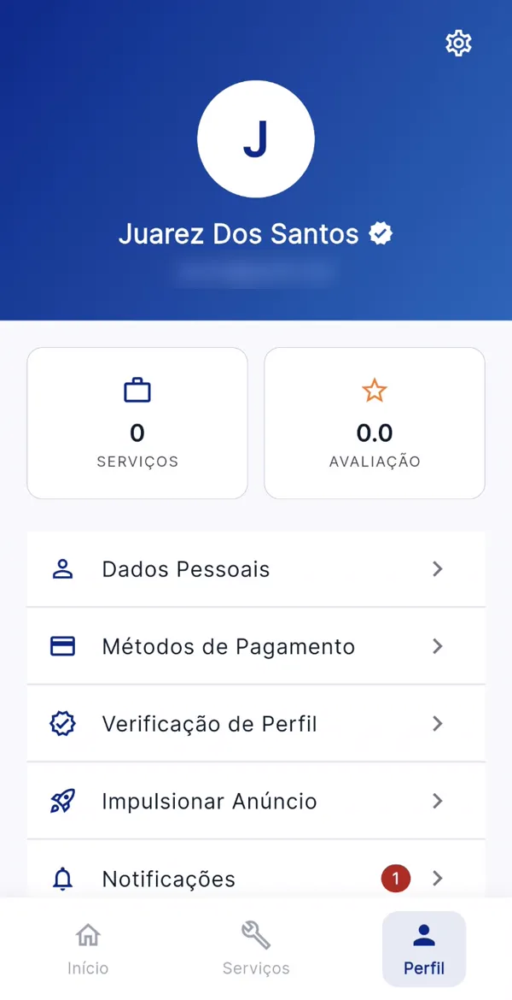

# iNeed

<p align="center">
  
</p>

<h3 align="center">Contrate com confiança quem vai entrar na sua casa.</h3>

<p align="center">
  <a href="https://ineed-app.netlify.app"><b>🌐 Acesse o site: ineed-app.netlify.app</b></a>
  &nbsp;·&nbsp;
  <a href="https://github.com/rafaellourenco10/iNeed-App/releases/latest/download/ineed.apk"><b>📲 Baixar o APK (Android)</b></a>
</p>

Marketplace mobile que conecta clientes a prestadores de serviços pontuais (eletricista, encanador, pintor, faxina e outros), com backend próprio integrado ao Firebase.

<p align="center">
  
  &nbsp;&nbsp;
  
</p>

## 🌐 Site oficial

O site **[ineed-app.netlify.app](https://ineed-app.netlify.app)** é a porta de entrada do projeto. Lá o usuário encontra:

- como o app funciona para quem contrata e para quem presta serviço;
- as categorias de serviço;
- como funciona o selo de verificado;
- prints das telas;
- o botão de download do APK e o passo a passo de instalação no Android.

O site fica na pasta [`site/`](site/) (HTML, CSS e JS puros, sem build) e é publicado na Netlify, com a configuração no [`netlify.toml`](netlify.toml).

## 📲 Instalação no celular

O app ainda não está na Play Store. A instalação é feita pelo APK:

1. Baixe o [`ineed.apk`](https://github.com/rafaellourenco10/iNeed-App/releases/latest/download/ineed.apk) (ou pelo botão do site).
2. Abra o arquivo no celular e permita a instalação de fontes desconhecidas para o navegador, se o Android pedir.
3. Toque em **Instalar**. Se o Play Protect avisar que não reconhece o app, toque em **Mais detalhes → Instalar mesmo assim**.

> O servidor da API usa o plano gratuito do Render. Se ninguém usou o app nos últimos minutos, o primeiro acesso pode levar cerca de 50 segundos.

## 👥 Membros da Equipe

* **Rafael R. Lourenço** — Desenvolvedor responsável pela concepção e construção do projeto: arquitetura da aplicação, desenvolvimento completo do app Flutter (todas as telas, navegação, design system e integrações), desenvolvimento do backend Node.js/Express, integração com Firebase (Authentication + Firestore) e deploy em produção no Render.
* **João Wilson Cunha Silva Pereira** — Responsável pela documentação inicial do projeto e levantamento de requisitos das interfaces de cliente e prestador.
* **Victor Hugo Vicente** — Responsável pela modelagem inicial do banco de dados (estrutura de coleções de Clientes e Prestadores).
* **Nikolas Eduardo da Silva** — Responsável pela documentação do processo de testes e pela separação conceitual dos ambientes de desenvolvimento e produção.
* **Savio Santos** — Responsável pelos POPs de gestão de Sprint (Scrum) e de gerenciamento de requisitos.

## 📝 Sobre o Projeto

O **iNeed** conecta pessoas que precisam de um serviço pontual a profissionais aptos a realizá-lo. A plataforma oferece uma solução prática tanto para quem precisa contratar quanto para quem presta o serviço e busca renda extra com mais visibilidade.

**Para Clientes:**
* Encontrar profissionais disponíveis com rapidez, filtrando por especialidade e preço.
* Enviar propostas de serviço diretamente pelo app (título, descrição, data, horário, endereço — o valor já é o valor/hora cadastrado pelo prestador).
* Acompanhar o status de cada solicitação (pendente, em andamento, concluída) e falar com o prestador pelo WhatsApp.
* Avaliar o serviço concluído com estrelas, elogios rápidos e comentário.

**Para Prestadores:**
* Cadastrar-se com especialidade, valor/hora e biografia.
* Receber e gerenciar propostas recebidas dos clientes, com autonomia para aceitar ou recusar.
* Definir chave Pix e formas de pagamento aceitas (Dinheiro/Pix/Cartão/Todas as formas).
* Acompanhar avaliações reais no perfil público, com média recalculada automaticamente.
* Enviar documento com foto e comprovante de qualificação para ganhar o **selo de verificado**, visível para os clientes.

**Para a Equipe iNeed:**
* Painel web de validação para analisar os documentos enviados pelos prestadores e aprovar ou recusar (com motivo) cada verificação.

## ✅ Estado Atual

**App Flutter** — completo, com dados reais de ponta a ponta (sem mocks):
- Onboarding, cadastro unificado (cliente/prestador), login com email, CPF ou celular (Firebase Auth)
- Home e pedidos (cliente) · Home e propostas (prestador — sem aba de busca separada, já tem busca dentro da Home), todos com dados reais do backend
- Fluxo completo de contratação — proposta → aceitar/recusar → concluir → avaliar — com contato via WhatsApp nos dois sentidos (mensagem pré-programada) e notificações in-app a cada etapa
- Perfil compartilhado: dados pessoais editáveis, notificações (com badge de não lidas), método de pagamento (chave Pix + formas aceitas — Dinheiro/Pix/Cartão/Todas as formas — exclusivo do prestador), tema claro/escuro e exclusão de conta (reconfirma senha e apaga em cascata os dois papéis — propostas, avaliações e notificações)
- Quem é cliente e prestador na mesma conta troca de perfil pelo menu sem precisar deslogar
- Categoria "Faz tudo" para prestador com mais de uma especialidade
- Card "Impulsione seu anúncio" na home do prestador (destaque pago futuro — ver "Em andamento")
- **Verificação de perfil:** o prestador fotografa (câmera ou galeria) um documento com foto e um comprovante de qualificação e envia para análise; a tela mostra o status (em análise, aprovado ou recusado com o motivo) e permite reenviar após recusa. Fotos são comprimidas no aparelho e sobrevivem ao Android encerrar o app com a câmera aberta
- **Selo de verificado** ao lado do nome no card da busca/home do cliente, no perfil público do prestador, na home do prestador e na tela de perfil — só para quem foi aprovado
- **Puxar para atualizar** em todas as telas que buscam dados do servidor (home, busca, pedidos, propostas, notificações, perfil, perfil do prestador e verificação), inclusive com a lista vazia
- Sessão salva no aparelho se revalida sozinha com o backend ao abrir o app, e desloga automaticamente se o token expirar
- Design system Material 3 com identidade visual própria, navegação por abas

**Backend (Node.js + Express)** — publicado em produção:
- API REST completa: autenticação, prestadores, propostas, avaliações, notificações e verificações de perfil
- Login e cadastro validam de verdade contra o Firebase (não é mock), com telefone e CPF únicos entre contas
- Middleware de autenticação por token JWT, permissões por papel (transições de status de proposta validadas, IDOR fechado)
- Deploy automático no [Render](https://render.com) a cada push na `main`: `https://ineed-app-9lzp.onrender.com`

**Painel de validação (web)** — servido pelo próprio backend em [`/admin`](https://ineed-app-9lzp.onrender.com/admin):
- Página única (`backend/public/admin.html`), sem build, no padrão de ferramentas de revisão KYC: fila de envios à esquerda, documento grande no centro (zoom, arrastar, girar) e painel de decisão à direita
- Checklist obrigatório antes de aprovar: nome do documento confere com o cadastro, documento legível e válido, comprovante é da especialidade e está em nome do prestador
- Recusa com motivos prontos + detalhe; o prestador recebe notificação e vê o motivo no app
- Registra quem analisou e quando; atalhos de teclado; funciona também no celular
- **Acesso:** qualquer pessoa com o link vê só a tela de login. Os documentos só aparecem para contas do iNeed cujo e-mail esteja na variável `ADMIN_EMAILS` do Render (separados por vírgula) — a checagem é feita no backend. Para dar acesso a um membro, basta acrescentar o e-mail dele nessa variável
- No plano gratuito do Render o servidor "dorme" após ~15 min sem uso; o primeiro acesso depois disso leva cerca de 50 segundos

**Firebase** — projeto configurado e conectado:
- Authentication (Email/Senha) e Cloud Firestore ativos
- Todo o ciclo cliente↔prestador (cadastro, login, propostas, avaliações) grava e lê dados reais
- Verificações ficam em `verificacoes/{uid}` (status, motivo, quem analisou) e as imagens em `verificacoes/{uid}/arquivos/{tipo}` como base64 (limite de ~600 KB por imagem, validado no backend) — sem Firebase Storage, que exige o plano Blaze. Aprovar grava `verificado: true` em `usuarios/{uid}`. Excluir a conta apaga também os documentos

**Build Android:**
- APKs de teste gerados sob demanda para instalação direta em aparelhos físicos, fora do Play Store — assinados com chave debug por enquanto

**Em andamento para a v1.0.0:**
- Testes automatizados (backend e Flutter)
- Build de produção assinado para publicação nas lojas
- Impulsionar anúncio (destaque pago na busca) — tela já existe no app, pagamento ainda não implementado
- Migrar as imagens de verificação para o Firebase Storage caso o projeto passe para o plano Blaze

## 💻 Tecnologias

* **Frontend Mobile:** Flutter, Dart, Provider (state management), image_picker (câmera/galeria)
* **Painel de validação:** HTML, CSS e JavaScript puros, servidos pelo backend
* **Backend:** Node.js, Express, Firebase Admin SDK
* **Banco de Dados / Auth:** Firebase Authentication + Cloud Firestore
* **Hospedagem do Backend:** Render
* **Controle de Versão:** Git e GitHub

## 📂 Documentação

**Planejamento**
* [Visão Geral do Projeto](docs/planning/project-vision.md)
* [Backlog do Produto](docs/planning/backlog.md)
* [Roadmap](docs/planning/roadmap.md)

**Fluxo de Trabalho**
* [Desenvolvimento vs. Produção](docs/workflow/development-vs-production.md)
* [Organização da Equipe](docs/workflow/team-organization.md)
* [Kanban](docs/workflow/kanban.md) / [Gantt](docs/workflow/gantt.md)

**Processos (POPs)**
* [docs/pops/](docs/pops/)

**Produto e Design**
* [PRODUCT.md](PRODUCT.md) — contexto do produto, usuários e princípios
* [backend/DESIGN.md](backend/DESIGN.md) — sistema visual do painel de validação

## 🚀 Como rodar o projeto

Clonar o repositório:
```bash
git clone https://github.com/rafaellourenco10/iNeed-App.git
```

**App Flutter** (pasta `src/`):
```bash
cd src
flutter pub get
flutter run
```

### Gerar o APK e publicar uma nova versão

```bash
cd src
flutter build apk --release
```

O arquivo sai em `src/build/app/outputs/flutter-apk/app-release.apk`. Para publicar uma nova versão, atualize o `version` no `pubspec.yaml`, gere o APK e crie uma release no GitHub (marcada como **Latest**, não como pre-release) com o arquivo renomeado para exatamente `ineed.apk`. O botão do site sempre baixa a release mais recente, então o site não precisa ser alterado (só o tamanho exibido, em `site/main.js`, se mudar muito).

**Backend** (pasta `backend/`) — só necessário para rodar localmente, já que o backend em produção está publicado no Render:
```bash
cd backend
npm install
npm run dev
```
Requer um `.env` com `PORTA`, `FIREBASE_WEB_API_KEY`, `ADMIN_EMAILS` (e-mails com acesso ao painel, separados por vírgula) e a credencial do Firebase (`serviceAccountKey.json` local ou `FIREBASE_SERVICE_ACCOUNT`) — ver [docs/development-environment.md](docs/development-environment.md).

Com o backend rodando, o painel de validação abre em `http://localhost:3000/admin` (usa o mesmo Firebase de produção).
